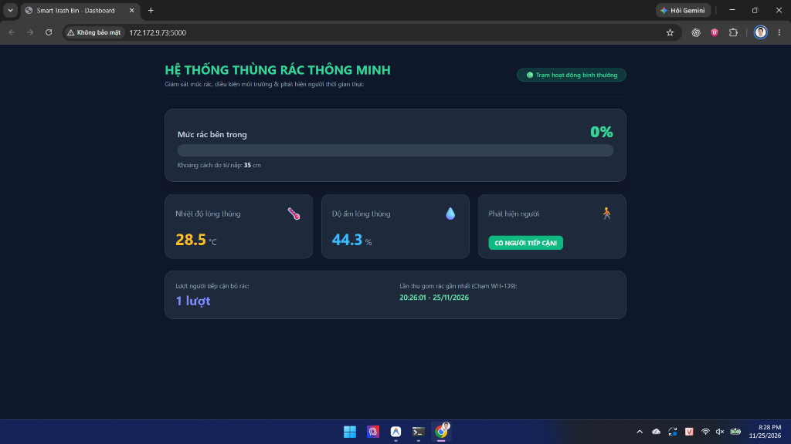
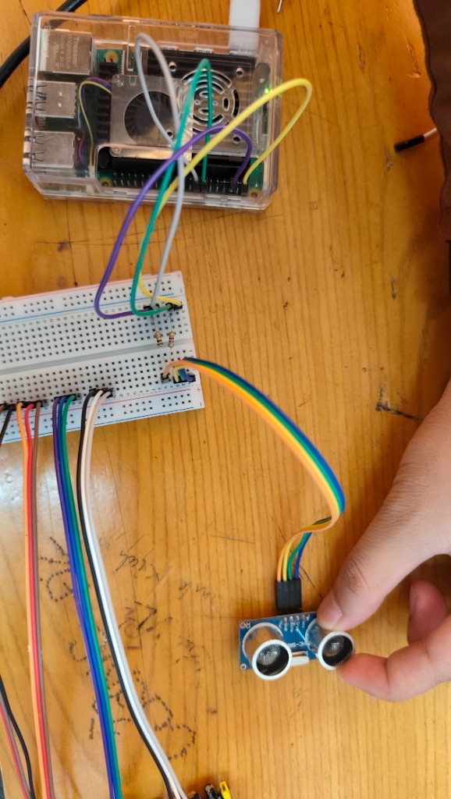
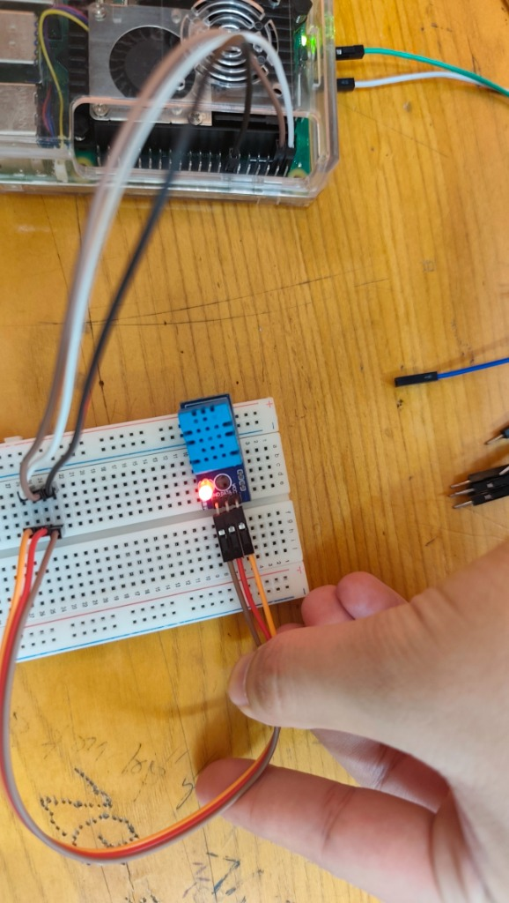
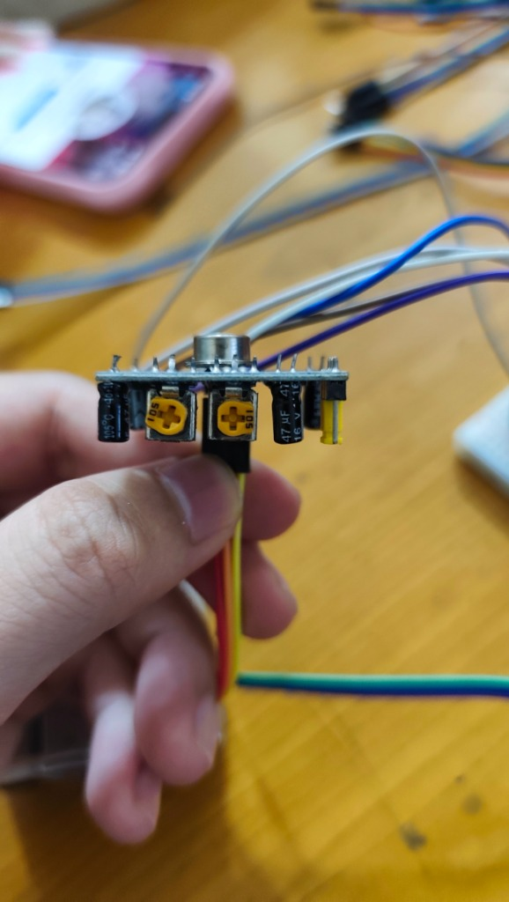

# AIoT Intelligent Waste Bin — Thùng rác thông minh ứng dụng AIoT

**Samsung Innovation Campus (SIC) – IoT Course Capstone Project**  
**Nhóm thực hiện:** Nhóm 4 – Lớp CNTTK22M

---

## 1. Thành viên nhóm & Phân công nhiệm vụ

| STT | Họ và Tên | Mã SV | Lớp | Vai trò & Nhiệm vụ chính |
| :---: | :--- | :--- | :--- | :--- |
| 1 | **Nguyễn Ngọc Đạo** | `DTC235200172` | CNTTK22M | **Nhóm trưởng** – Kiến trúc tổng thể, Edge Web Server Flask đa luồng, REST API, Quản lý GitHub |
| 2 | **Phùng Văn Duy** | `DTC235200941` | CNTTK22M | Phần cứng – Cảm biến siêu âm HC-SR04 & thiết kế mạch bảo vệ đơn 4.7kΩ |
| 3 | **Triệu Tiến Đạt** | `DTC235200184` | CNTTK22M | Phần cứng – Cảm biến chuyển động hồng ngoại PIR HW-416A (thấu kính Fresnel, chế độ L) |
| 4 | **Hoàng Thị Biên** | `DTC235200960` | CNTTK22M | Nhúng & Driver – Linux Kernel IIO Driver cho DHT11 (`GPIO 4`) & cảm biến chạm WH-139 (`GPIO 27`) |
| 5 | **Hà Thị Xuân** | `DTC235200986` | CNTTK22M | Frontend UI – Giao diện Web Dashboard Tailwind CSS Dark Mode & Fetch API 800ms |
| 6 | **Lê Kim Tuyến** | `DTC235210062` | CNTTK22M | Kiểm thử & Tài liệu – Kiểm thử End-to-End, phân tích lỗi, Báo cáo & Slide |

---

## 2. Kiến trúc phần cứng & Sơ đồ chân GPIO (Raspberry Pi 5)

Hệ thống vận hành trực tiếp tại biên trên **Raspberry Pi 5 Model B** (chip ngoại vi RP1) kết hợp 4 cảm biến:

| Thiết bị / Cảm biến | Chức năng | Chân cảm biến | Chân vật lý Pi 5 | Giao thức / Ghi chú kỹ thuật |
| :--- | :--- | :--- | :--- | :--- |
| **HC-SR04** (Siêu âm) | Đo khoảng cách & % mức rác (0–35 cm) | `VCC` / `GND`<br>`TRIG` / `ECHO` | Pin 2 (5V) / Pin 6<br>Pin 16 (`GPIO 23`) / Pin 18 (`GPIO 24`) | **Chỉ dùng 1 điện trở 4.7kΩ** nối tiếp chân Echo ($\approx 0.36\text{mA}$ qua diode kẹp nội 3.3V RP1) |
| **HW-416A / HC-SR501** (PIR) | Phát hiện người tiếp cận & đếm lượt | `VCC` / `OUT` / `GND` | Pin 4 (5V) / Pin 11 (`GPIO 17`) / Pin 9 | Jumper chế độ **L** (Single Trigger), vặn trễ `105` tối thiểu (~3s), gắn thấu kính Fresnel |
| **DHT11** (Nhiệt độ & Độ ẩm) | Theo dõi vi khí hậu bên trong thùng | `VCC` / `DATA` / `GND` | Pin 2 (5V) / Pin 7 (`GPIO 4`) / Pin 14 | Đọc qua **Linux Kernel IIO Driver** (`dtoverlay=dht11,gpiopin=4`) |
| **WH-139 / TTP223** (Chạm) | Xác nhận thu gom & chốt lịch sử dọn rác | `VCC` / `SIG` / `GND` | Pin 17 (3.3V) / Pin 13 (`GPIO 27`) / Pin 20 | Digital Capacitive Touch, cấp nguồn 3.3V trực tiếp |

---

## 3. Công nghệ & Giao thức sử dụng

- **Ngôn ngữ & Runtime:** Python 3.11+ trên Raspberry Pi OS 64-bit (Linux Kernel 6.6+).
- **Xử lý đa luồng (`threading`):** Tách biệt luồng đọc cảm biến siêu âm/PIR/chạm (chu kỳ 300ms) và luồng đọc nhiệt ẩm DHT11 Kernel `sysfs` (chu kỳ 2.5s) khỏi Web server HTTP.
- **Web Server & API:** Flask (`0.0.0.0:5000`) cung cấp endpoint `GET /api/data` trả về JSON thời gian thực:
  ```json
  {
    "distance": 35.0,
    "fill_pct": 0.0,
    "temperature": 28.5,
    "humidity": 44.3,
    "person_detected": true,
    "usage_count": 1,
    "last_cleaned": "20:26:01 - 25/11/2026",
    "alert": "Bình thường"
  }
  ```
- **Giao diện Frontend:** HTML5 + Tailwind CSS (Dark Mode) + JavaScript `fetch('/api/data')` cập nhật mỗi `800ms`.

---

## 4. Hướng dẫn cài đặt & Chạy trên Raspberry Pi 5

### Bước 1: Kích hoạt Linux Kernel IIO Driver cho DHT11
Thêm dòng sau vào `/boot/firmware/config.txt` trên Raspberry Pi 5 và khởi động lại (`sudo reboot`):
```ini
dtoverlay=dht11,gpiopin=4
```

### Bước 2: Cài đặt thư viện hệ thống
```bash
sudo apt update
sudo apt install python3-flask python3-gpiozero python3-lgpio -y
```

### Bước 3: Clone mã nguồn và Khởi chạy
```bash
git clone https://github.com/ngocdao102005/SIC_IoT2_Group2.git
cd SIC_IoT2_Group2
python3 app.py
```
Mở trình duyệt trên điện thoại hoặc máy tính cùng mạng Wi-Fi và truy cập `http://<IP-CUA-PI>:5000`.

---

## 5. Hình ảnh sản phẩm & Giao diện thực tế

### Giao diện Web Dashboard thời gian thực


### Hình ảnh đấu nối mạch phần cứng thực tế
| Cảm biến siêu âm HC-SR04 & Trở 4.7kΩ | Cảm biến nhiệt ẩm DHT11 | Cảm biến hồng ngoại PIR HW-416A |
| :---: | :---: | :---: |
|  |  |  |
